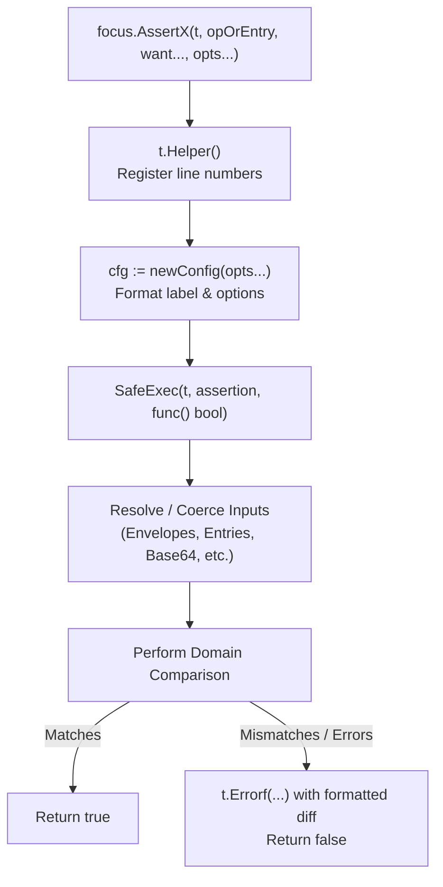

# Authoring Custom Focus Assertions & Require Mirrors

This guide is the complete technical reference for contributors authoring new assertion helpers in `pkg/focus` and their corresponding fatal mirrors in `pkg/focus/require/`.

---

## 1. Guiding Principles

Every assertion in `stellar-focus` follows two hard requirements:

1. **The failure message is the product**: A general assertion library can check equality. `stellar-focus` exists to decode complex Stellar XDR structures and explain *precisely* what differed in human-readable terms.
2. **Panic safety and deterministic offline execution**: Assertions run in user test suites. They must **never panic**, never access the network, and always report clear diagnostics when given malformed, missing, or unexpected input.

---

## 2. Anatomy of an Assertion in `pkg/focus`

Every boolean assertion in `pkg/focus` conforms to a strict pattern to ensure predictable behavior and satisfy the offline AST parity audit:



### Signature Conventions

1. **Prefix**: Must start with `Assert`, e.g., `AssertSignerWeight`, `AssertAccountThresholds`.
2. **First Parameter**: Must take `t TestingT` (or `TB`). `TestingT` is an interface defined in `pkg/focus/focus.go` that encompasses `Helper()`, `Errorf()`, `Fatalf()`, and `Name()`.
3. **Input Flexibility**: Accept `any` or `Value` for XDR inputs (`opOrEntry any`, `meta Value`, etc.) so callers can pass concrete structs, pointers, envelopes, operations, ledger entries, metadata changes, base64 strings, or raw byte slices.
4. **Options**: Take variadic options as the final parameter: `opts ...Option`.
5. **Return Type**: Must return `bool` (`true` on success, `false` on failure).

### Standard Template

```go
// AssertExample verifies that opOrEntry satisfies the expected condition.
func AssertExample(t TestingT, opOrEntry any, wantValue string, opts ...Option) bool {
	t.Helper()
	cfg := newConfig(opts...)
	assertion := cfg.assertionName("AssertExample")

	return SafeExec(t, assertion, func() bool {
		// 1. Resolve or coerce input
		entry, ok := extractEntry(t, assertion, opOrEntry)
		if !ok {
			return false
		}

		// 2. Perform comparison
		if entry.Value == wantValue {
			return true
		}

		// 3. Report formatted failure
		t.Errorf("%s: value mismatch\n\n  got  %s\n  want %s",
			assertion, entry.Value, wantValue)
		return false
	})
}
```

---

## 3. Safe Execution: `SafeExec` and `guard`

Stellar SDK XDR structures are generated unions that dereference fields without checking discriminants. If an assertion accesses an unset union arm or encounters malformed input, it can panic inside the SDK.

An unhandled panic will abort the entire `go test` process for the user. To prevent this, all assertion bodies touching generated XDR accessors must execute inside `SafeExec` or `guard`:

```go
// SafeExec converts any recovered panic into a structured test failure (t.Errorf).
// It returns false if fn panics or returns false, and true only if fn succeeds.
return SafeExec(t, assertion, func() bool {
    // Inspection and accessor logic here
    return true
})
```

When a panic occurs:
- `SafeExec` recovers the panic value and captures stack traces into a `PanicError`.
- It logs a clear failure message:
  ```text
  AssertExample: internal error while inspecting the value: ...
  This is a bug in stellar-focus; please report it with the XDR that triggered it.
  ```
- The test process continues cleanly.

---

## 4. Crafting Failure Messages

The failure message must follow standard `stellar-focus` formatting conventions:

1. **Short Headline**: State the assertion name (including label if `WithLabel` is used) and what failed:
   ```text
   AssertSignerWeight [step 1]: signer GAPB7…WYXZ weight is 10, want 20
   ```
2. **Account / Key Shortening**: Use `shorten(addr)` (e.g. `GCJNH…ZST6`) to keep long Stellar addresses readable in failure logs.
3. **Structured Diffs**: For composite objects or threshold triplets, format indented diff lines:
   ```text
   AssertAccountThresholds: account thresholds differ

     master weight is 1, want 2
     low threshold is 0, want 1

     got  master 1  low 0  med 2  high 3
     want master 2  low 1  med 2  high 3
   ```
4. **Never Guess**: If an envelope or metadata has no matching operation or entry, explicitly report that the account or operation was not found in the transaction rather than comparing against zeros.

---

## 5. The `pkg/focus/require` Fatal Mirror

`pkg/focus` assertions use `t.Errorf()` and return `false`, allowing test suites to continue and aggregate failures. The `pkg/focus/require` subpackage provides matching assertions that fail immediately with `t.Fatalf()`.

Every exported boolean `Assert*` function in `pkg/focus` **must** have an exact mirror in `pkg/focus/require/`:

### Mirror Conventions

1. **Name**: Exact assertion name stripped of the `Assert` prefix:
   - `focus.AssertSignerWeight` $\rightarrow$ `require.SignerWeight`
   - `focus.AssertAccountThresholds` $\rightarrow$ `require.AccountThresholds`
2. **Parameters**: Exact same parameter list, but types qualified with `focus.` if defined in `pkg/focus` (e.g. `t focus.TestingT`, `opts ...focus.Option`).
3. **Return Value**: Does **not** return a bool; returns void.
4. **Implementation**: Calls `t.Helper()` and passes `fatal(t)` to the `focus` assertion:

```go
// SignerWeight is focus.AssertSignerWeight, stopping the test on failure.
func SignerWeight(t focus.TestingT, opOrEntry any, signerKey string, wantWeight uint32, opts ...focus.Option) {
	t.Helper()
	focus.AssertSignerWeight(fatal(t), opOrEntry, signerKey, wantWeight, opts...)
}
```

The `fatal(t)` helper wraps `TestingT` in an adapter `fatalTB` that routes all `Errorf` calls directly to `Fatalf`.

---

## 6. AST Parity Audit (`audit.go`)

To guarantee 100% API parity between `focus` and `require`, the repository includes an offline AST audit tool in `pkg/focus/require/audit.go` and `audit_test.go`.

### How the Audit Works

The audit uses standard Go AST parsers (`go/parser`, `go/ast`) to inspect source files without importing or compiling them:

1. **Scans `pkg/focus`**: Identifies all exported functions whose name starts with `Assert`, has at least one parameter, and returns `bool`.
2. **Scans `pkg/focus/require`**: Identifies all exported wrapper functions.
3. **Validates Parity**:
   - Every `AssertX` in `pkg/focus` must have a corresponding `X` in `pkg/focus/require`.
   - No extraneous wrappers exist in `require` without a matching `focus` assertion.
   - Parameter counts, types (normalized), and variadicity must match exactly.

### Running the Audit

Run the audit test locally:

```sh
go test -v ./pkg/focus/require/ -run TestAudit
```

If parity is broken, the audit outputs actionable failure messages:
```text
require parity audit failed:
  - missing mirror AssertSignerWeight -> SignerWeight
  - signature mismatch AccountThresholds param 2: focus uint32, require int
```

---

## 7. Writing Tests for Assertions

Every new assertion requires unit tests in `pkg/focus/*_test.go`:

1. **Passing Cases**: Test valid matches with various input shapes (envelopes, operations, ledger entries, metadata changes).
2. **Failure Cases with Message Verification**: Use `internal/faketb` to assert on failure message content:
   ```go
   tb := faketb.New()
   if focus.AssertSignerWeight(tb, op, "GA...", 20) {
       t.Fatal("assertion passed with mismatched weight")
   }
   msg, err := tb.Message()
   if err != nil {
       t.Fatalf("reading message: %v", err)
   }
   if !strings.Contains(msg, "weight is 10, want 20") {
       t.Errorf("failure message did not contain expected diff:\n%s", msg)
   }
   ```
3. **Panic Safety**: Ensure malformed inputs (nil pointers, empty strings, invalid XDR) fail gracefully without panicking.
4. **Mirror Test**: Call the `require.*` mirror in at least one test case to verify integration.

---

## 8. Contributor Checklist

Before submitting a pull request adding an assertion:

- [ ] Assertion implemented in `pkg/focus/<domain>.go` taking `TestingT` as the first argument and returning `bool`.
- [ ] Assertion calls `t.Helper()` as its first statement.
- [ ] Code touches generated XDR accessors within `SafeExec` or `guard`.
- [ ] Failure message provides readable, formatted diffs and shortens long addresses.
- [ ] Matching mirror created in `pkg/focus/require/require.go` taking `focus.TestingT` and returning void.
- [ ] Unit tests added verifying passing conditions, failure diffs (via `faketb`), and invalid inputs.
- [ ] `go test -v ./pkg/focus/require/ -run TestAudit` passes with zero drift.
- [ ] All package tests pass (`go test ./...`) with race detector (`-race`).
