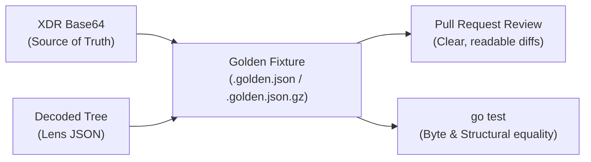

# Golden Fixtures Guide & CI Integration

This guide provides a comprehensive tutorial for managing golden test fixtures with `stellar-focus`, recording updates, resolving drift interactively, and integrating verification into GitHub Actions CI workflows.

---

## What Are Golden Fixtures?

In blockchain testing, transactions and ledger states are complex trees of nested XDR structures. Traditional assertion suites either hardcode brittle base64 strings or construct enormous in-memory structs.

`pkg/golden` stores the source of truth as readable JSON fixtures rather than opaque base64 blobs. Each fixture contains the base64 XDR alongside its decoded representation:



When a fixture changes, the pull-request diff shows the exact fields that changed (amounts, sequence numbers, memo values) rather than a meaningless replacement of base64 hashes.

---

## Anatomy of a Golden Fixture

Golden fixtures follow the `focus/v1` format schema ([`pkg/golden/fixture.schema.json`](../pkg/golden/fixture.schema.json)):

```json
{
  "format": "focus/v1",
  "type": "TransactionEnvelope",
  "description": "Payment of 100 XLM to test destination",
  "xdr": "AAAAAgAAAACS05bpJAmO8a9VODCyfbOCmh2YkUIwQLxzJkMlvAwp/AAAAGQAAAAAAAAAbwAAAAAAAAAAAAAAAQAAAAAAAAABAAAAAB4f...",
  "captured": {
    "network": "testnet",
    "networkPassphrase": "Test SDF Network ; September 2015",
    "ledger": 1234567,
    "txHash": "a1b2c3d4...",
    "at": "2026-11-21T12:00:00Z"
  },
  "decoded": {
    "v1": {
      "tx": {
        "fee": 100,
        "operations": [
          {
            "body": {
              "type": "Payment",
              "paymentOp": {
                "amount": 1000000000,
                "asset": "native",
                "destination": "GAPB7…WYXZ"
              }
            }
          }
        ]
      }
    }
  }
}
```

### Key Fields:
- **`format`**: Identifies layout version (`focus/v1`).
- **`type`**: The XDR struct type (`TransactionEnvelope`, `TransactionMeta`, `LedgerKey`, etc.).
- **`xdr`**: The base64-encoded binary payload. This is the **authoritative source of truth**.
- **`captured`** *(optional)*: Provenance metadata indicating when and where this fixture was captured from live networks.
- **`decoded`**: The human-readable lens tree, included so reviewers can see changes in pull requests.

---

## Writing Golden Tests

### 1. Single Fixture Assertion: `golden.Assert`

To test a single value against a golden fixture:

```go
package mytests

import (
    "testing"

    "github.com/stellar-optics/stellar-focus/pkg/golden"
)

func TestPaymentEnvelope(t *testing.T) {
    g := golden.New(t, "testdata")

    // got is whatever your generator or system under test produced
    gotEnvelope := BuildTestPayment()

    // Compares against testdata/TestPaymentEnvelope.golden.json
    g.Assert(t.Name(), gotEnvelope)
}
```

If the golden file does not exist, `g.Assert` creates it automatically on the first run.

### 2. Table-Driven Fixture Assertion: `golden.AssertAll`

When testing a suite of variants or protocol edge cases:

```go
func TestTransactionVariants(t *testing.T) {
    g := golden.New(t, "testdata/variants")

    cases := []golden.Case{
        {
            Name:        "simple_payment",
            Value:       buildPaymentOp(),
            Description: "Standard native payment",
        },
        {
            Name:        "fee_bump",
            Value:       buildFeeBumpTx(),
            Description: "Fee bump transaction with inner failure",
        },
    }

    g.AssertAll(cases)
}
```

---

## Updating Fixtures with `-focus.update`

When your code changes intentionally and golden files need updating, pass `-focus.update`:

```sh
go test ./... -focus.update
```

The flag is namespaced with `-focus.` to prevent collisions with other test flags.

When run with `-focus.update`:
1. Re-encodes the new actual value to canonical XDR.
2. Re-generates the decoded lens tree.
3. Updates the on-disk `.golden.json` file.
4. Preserves provenance metadata (`captured`) if present.

---

## Interactive Drift Resolution with `focus golden resolve`

When updating multiple fixtures, reviewing proposed changes one by one prevents accidental test corruption.

Use the `focus golden resolve` command:

```sh
# Record proposed changes to an update staging directory
go test ./... -focus.update -output-dir updates/

# Interactively inspect diffs and accept/reject changes
focus golden resolve --candidate updates/ testdata/
```

### Interactive Actions:
- **`[y] accept`**: Overwrites the stored golden file with the proposed fixture.
- **`[n] reject`**: Keeps the current golden file and discards the proposal.
- **`[a] accept all`**: Accepts this and all remaining candidate fixtures.
- **`[q] quit`**: Aborts resolution, leaving remaining fixtures untouched.

---

## Compression (`.golden.json.gz`) & Schema Validation

### Compressed Fixtures
For large transaction streams or Soroban contract states with thousands of events, fixtures can be compressed with gzip:

- Name your fixture with a `.golden.json.gz` suffix.
- `pkg/golden` transparently decompresses on read and compresses on write.
- Normalizes CRLF and LF across Windows, macOS, and Linux to maintain byte-identical results.

### Schema Validation
Ensure all stored fixtures adhere to the specification:

```sh
focus golden lint testdata/
```

This validates every fixture against [`pkg/golden/fixture.schema.json`](../pkg/golden/fixture.schema.json), catching malformed types or missing fields before committing.

---

## CI Integration with GitHub Actions

Run fixture validation in CI to catch unexpected protocol changes or serializer regressions.

### GitHub Actions Workflow:

```yaml
name: Golden Fixture Verification

on:
  push:
    branches: [main]
  pull_request:

jobs:
  verify-fixtures:
    runs-on: ubuntu-latest
    steps:
      - uses: actions/checkout@v4

      - name: Set up Go
        uses: actions/setup-go@v5
        with:
          go-version: '1.25'

      - name: Verify Golden Fixtures
        run: |
          go test -race ./...

      - name: Install focus CLI
        run: go install ./cmd/focus

      - name: Verify Live Fixture Drift
        run: |
          focus verify testdata/ --drifted-only
```

### Why `--drifted-only`?
- Caches verification state in `.focus/verify-cache.json`.
- In recurring CI cron jobs or PR checks, `--drifted-only` re-checks only the fixtures that previously experienced drift on live RPC nodes, keeping CI fast and within API rate limits.
