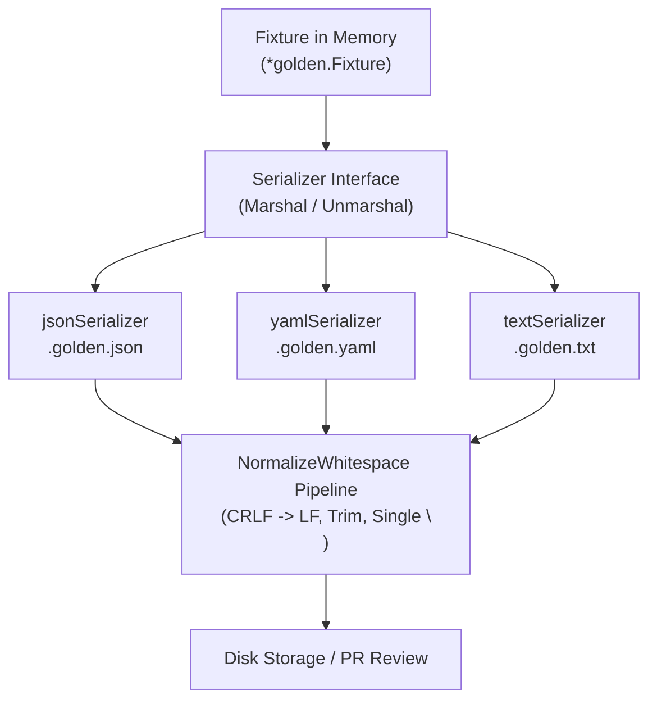
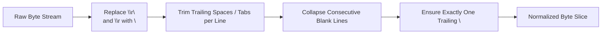

# Architecture Reference: Multi-Format Golden Serializer

This document details the architectural design, technical invariants, and implementation constraints of the multi-format golden fixture serializer in `pkg/golden/serializer.go`.

---

## 1. Overview & Architectural Role

`pkg/golden` provides deterministic golden testing for Stellar XDR structures. Rather than comparing opaque base64 strings or binary blobs, golden fixtures preserve both:
1. The **base64 XDR** (authoritative source of truth).
2. The **decoded lens tree** (human-readable structure displayed during pull-request reviews).

`pkg/golden/serializer.go` serves as the abstraction boundary separating the in-memory representation of fixtures (`*Fixture`) from disk encodings.



### The `Serializer` Interface

```go
type Serializer interface {
    Format() Format
    Marshal(f *Fixture) ([]byte, error)
    Unmarshal(data []byte) (*Fixture, error)
}
```

Format selection is handled via path extension heuristics (`SerializerForPath`) or explicit format tokens (`SerializerFor(YAML)`). Adding a new format requires implementing this single interface and registering its identifier in `SerializerFor`.

---

## 2. Zero External Dependencies Policy

`pkg/golden` is designed to be imported directly into third-party Go test suites. 

### Why Zero Dependencies Are Enforced

1. **Dependency Hygiene**: Adding common YAML libraries (such as `gopkg.in/yaml.v3`) introduces transitive dependencies into downstream consumer `go.mod` files. For minimal microservices and smart contract test suites, unwanted dependencies create dependency bloat and friction.
2. **Version Pinning Conflicts**: Downstream repositories often pin specific versions of YAML or diffing utilities. Forcing a dependency version from an assertion library causes dependency graph resolution conflicts.
3. **Security & Supply Chain**: A zero-external-dependency library eliminates third-party CVE surfaces in test infrastructure.

This invariant is strictly enforced at build and CI time:
- `TestLibraryStaysDependencyLight`: Validates that `pkg/focus`, `pkg/golden`, and `pkg/fuzz` depend exclusively on the Go standard library, `github.com/stellar/go-stellar-sdk`, and `github.com/stellar-optics/stellar-xdr-lens`.
- `deps_lint_test.go`: AST-based import check that pinpoints forbidden imports at file and line granularity.

---

## 3. The Custom YAML Serializer

To satisfy the zero-dependency rule while supporting developer-friendly YAML fixtures, `pkg/golden` contains a custom YAML parser and emitter tailored for structured fixture data.

### Supported YAML Subset

The parser implements a strict, unambiguous subset of YAML:

| Construct | Supported Syntax | Invariants |
| :--- | :--- | :--- |
| **Block Mappings** | `key: value`<br/>`  nested: value` | 2-space indentation; keys sorted alphabetically |
| **Block Sequences** | `- item1`<br/>`- item2` | Bare dashes on newlines or expanded sequence blocks |
| **Compact Sequences** | `- key: value` | Desugared automatically into expanded sequence entries |
| **Flow Empty Containers** | `{}`, `[]` | Used exclusively for empty maps and empty arrays |
| **Unquoted Scalars** | `format: focus/v1` | Unquoted strings, booleans (`true`/`false`), nulls |
| **Double-Quoted Scalars** | `"escaped \n \" string"` | Standard JSON/Go escape sequence parsing |
| **Single-Quoted Scalars** | `'literal ''quote'' string'` | Literal interpretation; doubled single quote `''` escape |

### Disallowed & Rejected Features

YAML 1.2 includes complex, ambiguous constructs that introduce non-determinism, parsing security risks, or memory overhead. The parser explicitly rejects these with actionable errors:

- **Tabs for Indentation**: Tabs are strictly prohibited (`a tab cannot be used for indentation`).
- **Anchors & Aliases**: `&anchor` and `*alias` references are forbidden to avoid cyclic structures and billion-laughs attacks.
- **Custom Tags**: Type tags (`!customTag`) are rejected.
- **Explicit Keys**: Complex key indicators (`? explicitKey`) are rejected.
- **Multi-line Block Scalars**: Folded (`>`) and literal (`|`) block scalar modes are rejected in favor of single-line escaped strings.
- **Duplicate Keys**: Parsing fails loudly if a duplicate mapping key is encountered at the same level.

---

## 4. Whitespace and Normalization Pipeline

Line ending and trailing whitespace discrepancies are the leading cause of false-positive diffs across operating systems (especially Windows CRLF vs Linux/macOS LF).

### The Normalization Pipeline (`NormalizeWhitespace`)

Every serializer runs both input data and output bytes through `NormalizeWhitespace`:



1. **CRLF Canonicalization**: All occurrences of `\r\n` and bare `\r` are converted to standard `\n`.
2. **Trailing Whitespace Removal**: Every line is stripped of trailing spaces and horizontal tabs (`strings.TrimRight(line, " \t")`).
3. **Blank Line Deduping**: Consecutive empty lines are collapsed to at most one blank line, preventing vertical drift.
4. **Single Trailing Newline**: The output slice is guaranteed to end with exactly one `\n`, eliminating `\ No newline at end of file` diff noise in git.

This guarantees that a checkout on Windows (`autocrlf=true`) produces byte-for-byte identical output to a Linux CI runner.

---

## 5. Performance and Memory Profile

The golden serialization layer is optimized for fast test suite execution:

1. **Deterministic Number Preservation**: Numeric values in XDR payloads (e.g. 64-bit int amounts, sequence numbers, ledger sequences) are preserved using `json.Number` rather than converting through `float64`, preventing precision truncation.
2. **Deterministic Map Ordering**: Maps and decoded trees are sorted lexicographically prior to serialization, ensuring 100% reproducible byte outputs regardless of Go's randomised map iteration order.
3. **Zero Dynamic Reflection**: Deserialization maps tokens directly into `Fixture` fields without heavy reflection or runtime schema evaluation.
4. **Re-encoding Avoidance**: During JSON deserialization, the large `decoded` tree is captured as `json.RawMessage` to round-trip without unnecessary object allocations.
