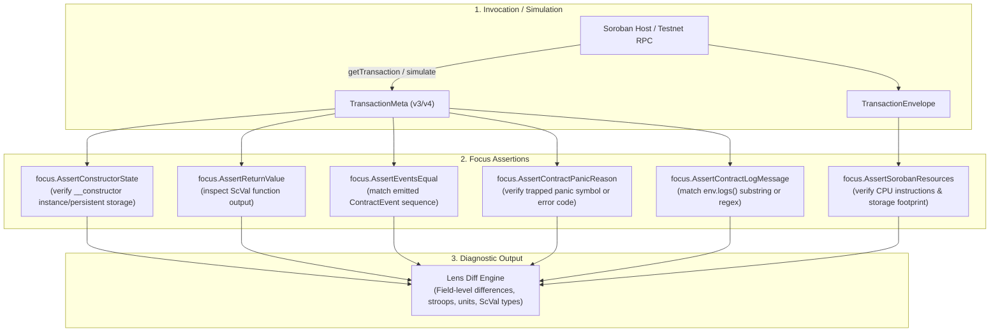

# Soroban Smart Contract Testing Guide

This guide walks through testing Soroban smart contracts in Go using `stellar-focus`.

Testing Soroban contracts with raw XDR strings or generic equality libraries produces opaque diffs when tests fail. `stellar-focus` provides high-level, XDR-aware assertions that inspect contract storage, return values, event streams, traps, diagnostic logs, and resource budgets, rendering plain-English diffs that show exactly which fields diverged.

A complete runnable test suite demonstrating all patterns in this guide is available in [`examples/soroban_test.go`](../examples/soroban_test.go).

---

## Architecture of a Soroban Test



---

## Step 1: Testing Deployment & Constructor State

Soroban contracts initialize their state during deployment via `__constructor`. The constructor writes initial parameters to contract instance storage, persistent storage, or temporary storage.

Use `focus.AssertConstructorState` to assert that deployment properly configured the contract without manually traversing ledger entry changes:

```go
func TestContractDeployment(t *testing.T) {
    // meta is the transaction metadata resulting from contract deployment
    focus.AssertConstructorState(t, meta, focus.ConstructorState{
        ContractID: "CAIRC…DB3V",
        Owner:      "GAAQC…DZ7H",
        OwnerKey:   "admin",
        Entries: map[string]any{
            "decimals": uint32(7),
            "name":     "FocusToken",
            "supply":   uint64(1_000_000),
        },
    })
}
```

### What this checks:
- Verifies that the instance storage entry for `ContractID` was created.
- Verifies that `OwnerKey` ("admin") binds the expected account or contract address.
- Compares each key in `Entries` against instance or persistent storage.
- If a value diverges, the failure message pinpoints the differing key:

```text
AssertConstructorState: contract CAIRC…DB3V was initialized with different state — 1 difference

  differences (1):
    ~ decimals
        want  7
        got   6  (instance storage)
```

---

## Step 2: Asserting Function Return Values

When calling a contract method, the result is captured in `SorobanTransactionMeta.ReturnValue` as an `xdr.ScVal`.

Use `focus.AssertReturnValue` to verify output:

```go
func TestTokenBalance(t *testing.T) {
    // Assert the return value matches an expected ScVal (or primitive)
    focus.AssertReturnValue(t, meta, xdr.ScVal{
        Type: xdr.ScValTypeScvU64,
        U64:  &expectedBalance,
    })
}
```

If your contract specification (`[]xdr.ScSpecEntry`) is available, you can also use `focus.AssertReturnValueWithSpec` to decode typed structures, maps, or enums with named fields.

---

## Step 3: Matching Emitted Contract Events

Contracts emit events to signal state transitions to external listeners (such as transfers, mints, or approvals).

Use `focus.AssertEventsEqual` to assert on exact event sequences:

```go
func TestTransferEvent(t *testing.T) {
    focus.AssertEventsEqual(t, meta, []focus.Event{
        {
            ContractID: "CAIRC…DB3V",
            Topics:     []any{"transfer", userAccountID},
            Data:       xdr.ScVal{Type: xdr.ScValTypeScvU64, U64: &transferAmount},
        },
    })
}
```

### Flexible Matching
- Omit `ContractID` to match events emitted by any contract.
- Topics can be strings, symbols, addresses, or wildcards.
- Any discrepancy reports the exact event index and the mismatched topic or data payload.

---

## Step 4: Testing Trapped Calls & Panic Reasons

When a contract call fails or panics (e.g. calling `panic_with_error!`), Soroban traps execution and records the failure in the transaction result and diagnostic event stream.

Use `focus.AssertContractPanicReason` to verify that the contract aborted for the expected reason:

```go
func TestUnauthorizedWithdrawal(t *testing.T) {
    // Assert the invocation trapped with contract error code 101
    focus.AssertContractPanicReason(t, metaOrResult, uint32(101))

    // Or assert on a custom panic symbol string
    focus.AssertContractPanicReason(t, metaOrResult, "InsufficientFunds")
}
```

### Failure Diagnostics
If the contract succeeded when it should have panicked, or trapped with a different error code, `AssertContractPanicReason` dumps the host's error trace:

```text
AssertContractPanicReason: transaction trapped with Error(Contract, #102), want Error(Contract, #101)

  host diagnostic events (2):
    [0] fn_call     depth 0  contract CAIRC…DB3V  topics["withdraw"]
    [1] error       depth 0  Error(Contract, #102)
```

---

## Step 5: Matching Diagnostic Log Messages

Soroban contracts emit runtime logs via `env.logs()`. Diagnostic events carry these strings in the transaction metadata.

Use `focus.AssertContractLogMessage` to search diagnostic logs using literal substrings or regular expressions:

```go
func TestContractLogging(t *testing.T) {
    // Literal substring matching
    focus.AssertContractLogMessage(t, meta, "deposit 500 stroops")

    // Regular expression matching (enclosed in /.../)
    focus.AssertContractLogMessage(t, meta, `/deposit \d+ stroops for account G[A-Z0-9]+/`)
}
```

If no log message matches the pattern, `AssertContractLogMessage` prints every diagnostic event emitted during the invocation so you can immediately see what the contract actually logged.

---

## Step 6: Verifying Resource Budgets & Fees

Transactions on Soroban must declare resource limits for CPU instructions and disk read/write bytes. Overestimating wastes reserve fees; underestimating causes the transaction to abort with `txSOROBAN_INVALID`.

Use `focus.AssertSorobanResources` and `focus.AssertResourceFee` to verify resource configurations:

```go
func TestResourceBudget(t *testing.T) {
    // Check CPU instructions, read bytes, and write bytes
    focus.AssertSorobanResources(t, envelope, 500_000, 1024, 2048)

    // Check refundable resource fee
    focus.AssertResourceFee(t, envelope, 25_000)
}
```

---

## Using `pkg/focus/require` for Fatal Assertions

Every assertion in `pkg/focus` has an identical mirror in `pkg/focus/require` that calls `t.Fatalf` on failure, stopping execution immediately when a prerequisite step fails:

```go
import (
    "github.com/stellar-optics/stellar-focus/pkg/focus"
    "github.com/stellar-optics/stellar-focus/pkg/focus/require"
)

func TestLifecycle(t *testing.T) {
    // Must succeed before continuing test execution:
    require.ConstructorState(t, deployMeta, focus.ConstructorState{...})

    // Assert further steps:
    focus.AssertReturnValue(t, invokeMeta, expectedOutput)
    focus.AssertContractLogMessage(t, invokeMeta, "executed successfully")
}
```

---

## Running the Runnable Example

Check out [`examples/soroban_test.go`](../examples/soroban_test.go) to see a complete runnable suite:

```sh
go test -v ./examples/...
```
